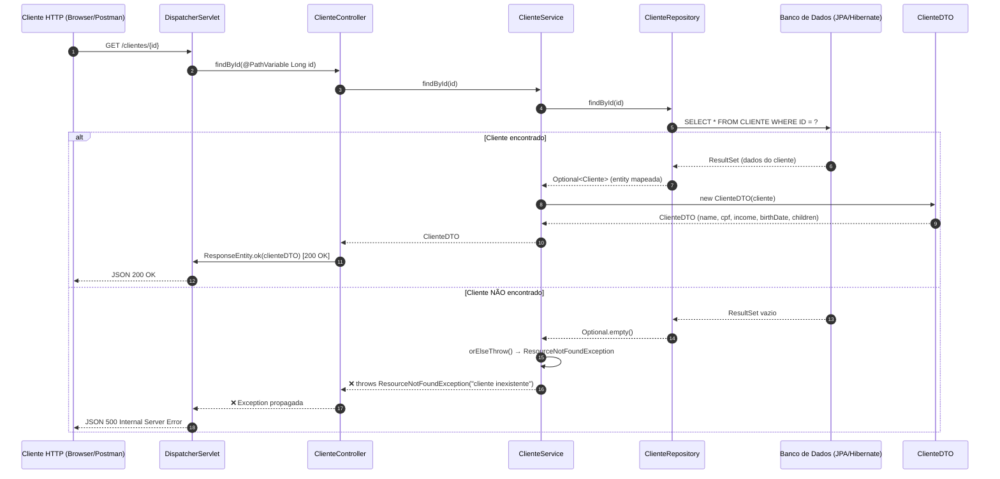

# Fluxo do Endpoint `GET /clientes/{id}`

## Visão Geral

Este documento descreve o fluxo completo da requisição HTTP, desde a chegada no endpoint até o retorno da resposta, incluindo os caminhos de sucesso e erro.

## Fluxograma



## Camadas Envolvidas

| Camada | Classe | Responsabilidade |
|--------|--------|------------------|
| **Controller** | `ClienteController` | Recebe a requisição HTTP, extrai o `id` do path, delega ao Service e retorna `ResponseEntity` |
| **Service** | `ClienteService` | Contém a lógica de negócio: busca no repositório e converte `Cliente` para `ClienteDTO` |
| **Repository** | `ClienteRepository` | Interface `JpaRepository` que fornece o método `findById()` via Spring Data JPA |
| **Model** | `Cliente` | Entidade JPA mapeada para a tabela `CLIENTE` |
| **DTO** | `ClienteDTO` | Objeto de transferência de dados com validações (`@NotBlank`, `@CPF`, `@PastOrPresent`) |
| **Exception** | `ResourceNotFoundException` | Exceção lançada quando o cliente não é encontrado |

## Fluxo de Sucesso (200 OK)

1. **Cliente HTTP** envia `GET /clientes/{id}`
2. **DispatcherServlet** roteia para `ClienteController.findById(id)`
3. **Controller** delega para `ClienteService.findById(id)`
4. **Service** chama `ClienteRepository.findById(id)`
5. **Repository** executa consulta SQL via Hibernate na tabela `CLIENTE`
6. **Banco de Dados** retorna os dados do cliente
7. **Service** converte a entity `Cliente` para `ClienteDTO` via construtor
8. **Controller** retorna `ResponseEntity.ok()` com status `200 OK`
9. **Cliente HTTP** recebe o JSON com os dados do cliente

## Fluxo de Erro (500 Internal Server Error)

1. **Cliente HTTP** envia `GET /clientes/{id}` com um ID inexistente
2. **DispatcherServlet** roteia para `ClienteController.findById(id)`
3. **Controller** delega para `ClienteService.findById(id)`
4. **Service** chama `ClienteRepository.findById(id)`
5. **Repository** retorna `Optional.empty()`
6. **Service** lança `ResourceNotFoundException("cliente inexistente")`
7. A exceção é propagada até o **DispatcherServlet**
8. **Cliente HTTP** recebe `500 Internal Server Error`

> **Nota:** A `ResourceNotFoundException` é uma `RuntimeException` sem um `@ControllerAdvice` dedicado, portanto o Spring retorna o erro padrão `500`. A classe `ResponseError` existe no projeto, mas não está sendo utilizada por um handler global de exceções.

## Estrutura da Resposta de Sucesso

```json
{
  "name": "Nome do Cliente",
  "cpf": "123.456.789-00",
  "income": 5000.00,
  "birthDate": "1990-01-01",
  "children": 2
}
```
